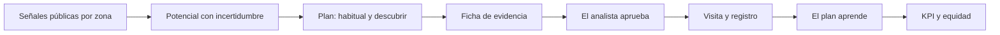

# COM-01 · Brújula comercial que aprende de cada visita

*Yupana Labs · Cajathon 2026 · Concepto de solución*

**Resumen.** Plan semanal de prospección que combina la ruta habitual del analista con zonas poco exploradas, explica qué se sabe y qué no de cada una y aprende del resultado de las visitas. Complementa los mecanismos actuales. Unidad: la zona, sin datos personales. Se mide en clientes nuevos por cada 100 visitas.

- **Problema:** Se aprende sobre todo de donde ya se va: la falta de información sobre una zona puede confundirse con falta de potencial.
- **Solución:** Plan semanal que combina la ruta habitual con zonas poco exploradas, con ficha de evidencia por zona, y aprende del resultado de las visitas. El analista decide.
- **Impacto esperado:** KPI: clientes nuevos por 100 visitas; conversión, desembolsos, costo por cliente nuevo y primer acceso. En simulación propia, la mezcla quedó siempre en 91 % o más de la mejor estrategia (solo donde ya hay clientes: hasta 47 %; puntaje fijo: hasta 62 %).
- **Tecnología:** Python, FastAPI, scikit-learn, SQLite, React; esquema bayesiano con muestreo de Thompson y agente acotado con proveedor intercambiable.
- **Preexistente:** Generador de territorio sintético (7 pruebas) y script de auditoría de estrategias, creados el 25.11.2026. Todo lo demás se construye en el evento.
- **Funcionalidad crítica (se construye en el evento):** Plan semanal con ficha por zona, aprobación del analista y actualización al registrar resultados.
- **Factibilidad:** 31 de 32 horas-persona (supuesto), con mínimo viable. Cifras medidas sobre datos sintéticos propios.

**Flujo:**

Señales públicas por zona → Potencial con incertidumbre → Plan: habitual y descubrir → Ficha de evidencia → El analista aprueba → Visita y registro → El plan aprende → KPI y equidad

