# NEG-02 · Asesor de oportunidades con consentimiento verificable para un ecosistema financiero abierto

*Yupana Labs · Cajathon 2026 · Concepto de solución*

**Resumen.** Sandbox de Open Finance simulado en el que la Caja recibe datos de otras entidades solo con consentimiento del cliente (alcance, vigencia, finalidad, revocación), arma su vista integral y propone productos con evidencia trazable al dato y al consentimiento que los originó. También sabe abstenerse ante sobreendeudamiento. El control de consentimiento vive en el código y se prueba. Se mide en tres brazos sintéticos: solo Caja, con consentimientos y consentimiento total.

- **Problema:** La información financiera del cliente está repartida entre instituciones. La Caja solo ve lo que el cliente hace con ella: pierde oportunidades y podría ofrecer crédito a quien ya está sobreendeudado (hipótesis del equipo).
- **Solución:** Sandbox de Open Finance simulado: la Caja recibe datos de otras entidades solo con consentimiento, arma una vista integral y propone productos con el dato y el consentimiento que los originó; también se abstiene ante sobreendeudamiento. Decide siempre el ejecutivo.
- **Impacto esperado:** KPI propuesto: % de clientes con una oportunidad válida identificada dentro de su consentimiento; cero usos fuera de consentimiento. Tres brazos sintéticos: solo Caja, con consentimientos y consentimiento total. Línea base por confirmar.
- **Tecnología:** Python, FastAPI, SQLite, scikit-learn y React; control de consentimiento en código; agente (Pydantic AI) con proveedor intercambiable y modo sin red.
- **Preexistente:** Generador de datos sintéticos (41 pruebas) con clientes, entidades, transacciones y consentimientos ficticios, creado el 21.11.2026. Todo lo demás se construye en el evento.
- **Funcionalidad crítica (se construye en el evento):** Cliente otorga consentimiento, la Caja consulta 3 o más entidades por el control de consentimiento, vista integral y ofertas o abstención con evidencia; al revocar, la vista se reduce de inmediato.
- **Factibilidad:** 28 a 36 horas-persona con recortes definidos. Medido sobre nuestro generador: la Caja sola ve 13 % de las oportunidades, con consentimientos 31 % y con información completa 95 % (techo mecánico): el consentimiento es lo que más limita.

**Flujo:**

Cliente otorga consentimiento → Control de consentimiento en código → Consulta a 3 o más entidades simuladas → Vista integral del cliente → Motor de oportunidades con evidencia → Agente explica o se abstiene → Ejecutivo decide → Auditoría y KPI en 3 brazos

```mermaid
flowchart LR
  N0["Cliente otorga consentimiento"]
  N1["Control de consentimiento en código"]
  N2["Consulta a 3 o más entidades simuladas"]
  N3["Vista integral del cliente"]
  N4["Motor de oportunidades con evidencia"]
  N5["Agente explica o se abstiene"]
  N6["Ejecutivo decide"]
  N7["Auditoría y KPI en 3 brazos"]
  N0 --> N1
  N1 --> N2
  N2 --> N3
  N3 --> N4
  N4 --> N5
  N5 --> N6
  N6 --> N7
```

