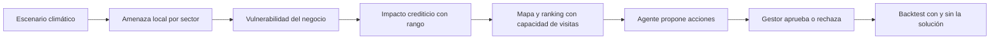

# RIE-01 · Radar Climático de Cartera: anticipar el riesgo climático y actuar antes, con los gestores disponibles

*Yupana Labs · Cajathon 2026 · Concepto de solución*

**Resumen.** El analista elige un escenario climático y la herramienta separa, con rangos, la cartera expuesta, la probablemente afectada y la mora adicional esperada. Un mapa y un ranking priorizan zonas y clientes según las visitas que cada agencia puede hacer, y un agente propone acciones del catálogo con su evidencia. El gestor decide. Se mide con un backtest sobre eventos simulados con resultado oculto, frente a azar y reglas simples.

- **Problema:** Lluvias, inundaciones y sequías pueden afectar a los microempresarios en zonas vulnerables o con actividades sensibles al clima. Hay que anticipar el riesgo sin asumir que exposición significa pérdida.
- **Solución:** Radar Climático de Cartera: ante un escenario, separa con rangos la cartera expuesta, la afectada y la mora adicional esperada; mapa y ranking según las visitas disponibles; un agente propone acciones de un catálogo por validar. Decide el gestor.
- **Impacto esperado:** KPI propuestos: cartera afectada identificada antes del evento, precisión frente a reglas simples, pérdida evitada (rango, con efectividades supuestas) y continuidad. Medido sobre datos sintéticos propios: ≈ 2,5× sobre el azar con visitas a ≈ 8 % de la cartera. Línea base por confirmar.
- **Tecnología:** Python, FastAPI, React; modelo calibrado con simulación de escenarios y optimización de visitas; agente con IA intercambiable y modo sin red.
- **Preexistente:** Generador de datos sintéticos (40 pruebas) y un script de auditoría de dificultad de los datos, creados antes del evento. Todo lo demás se construye en el evento.
- **Funcionalidad crítica (se construye en el evento):** Escenario, cartera expuesta, afectada y en mora con rango, ranking con capacidad de visitas, plan del agente aprobado o rechazado, y KPI con y sin la solución en tres a seis eventos.
- **Factibilidad:** 32 horas-persona; versión mínima comprometida (K1 y K2 en 3 eventos) y ampliada si alcanza. Medido sobre datos sintéticos propios: una fórmula de tres factores ya captura ≈ 18 % (azar ≈ 8 %); la ventaja del modelo está en el sector y en los rangos.

**Flujo:**

Escenario climático → Amenaza local por sector → Vulnerabilidad del negocio → Impacto crediticio con rango → Mapa y ranking con capacidad de visitas → Agente propone acciones → Gestor aprueba o rechaza → Backtest con y sin la solución

