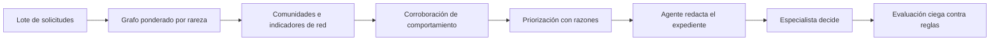

# RIE-02 · Mesa del especialista de redes: priorizar redes de riesgo con evidencia citada y sin acusar a clientes legítimos

*Yupana Labs · Cajathon 2026 · Concepto de solución*

**Resumen.** Convierte un lote de solicitudes en un grafo de personas, negocios, teléfonos, dispositivos, direcciones y referencias; prioriza los grupos conectados de forma inusual y entrega por cada red un expediente con evidencia citada y las explicaciones legítimas posibles. Una red solo sube si combina vínculos con comportamiento anómalo. La alerta dice «merece revisión», nunca «fraude»; decide el especialista. Se mide sobre redes simuladas y señuelos legítimos.

- **Problema:** Un fraude puede repartirse entre varias personas, negocios y solicitudes que, vistas una por una, parecen normales; pero compartir un dato no es fraude (familias, mercados, gremios). Hay que distinguir lo que merece revisión.
- **Solución:** Mesa del especialista: grafo de solicitudes, grupos conectados de forma inusual, priorización con razones y un expediente con evidencia citada y explicaciones legítimas. Solo sube la red que combina vínculos y comportamiento anómalo. Decide el especialista.
- **Impacto esperado:** Indicadores propuestos: precisión y recall sobre redes simuladas, menos falsos positivos frente a reglas simples a igual recall y calidad de la cola. Evaluación ciega con intervalos; línea base por confirmar.
- **Tecnología:** Python, networkx, scikit-learn, FastAPI, SQLite, React y Cytoscape.js; agente con IA intercambiable y verificador de citas.
- **Preexistente:** Generador de datos sintéticos (37 pruebas) con redes de fraude y relaciones legítimas, creado el 21.11.2026. Todo lo demás se construye en el evento.
- **Funcionalidad crítica (se construye en el evento):** Lote de solicitudes a redes priorizadas, cada una con expediente verificable, explicaciones legítimas y acción sugerida; sin alertar solo por relaciones; la decisión humana queda registrada.
- **Factibilidad:** Unas 29 a 31 horas-persona con núcleo intocable. Medido sobre datos sintéticos propios: marcar cualquier coincidencia detecta 90 % del fraude pero marca todos los señuelos (precisión 12 %); exigir dos tipos de vínculo detecta solo 43 %.

**Flujo:**

Lote de solicitudes → Grafo ponderado por rareza → Comunidades e indicadores de red → Corroboración de comportamiento → Priorización con razones → Agente redacta el expediente → Especialista decide → Evaluación ciega contra reglas

