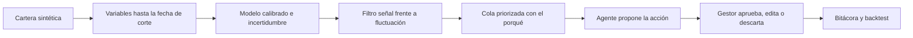

# RIE-03 · Alerta temprana explicada: la cola diaria que anticipa el deterioro de pago

*Yupana Labs · Cajathon 2026 · Concepto de solución*

**Resumen.** Cola diaria corta de clientes al día con riesgo de deterioro, cada uno con el porqué y una acción preventiva propuesta. Un modelo calibrado con incertidumbre, un filtro contra fluctuaciones normales (persistencia, estacionalidad, dos familias de señales) y un agente acotado. El gestor siempre decide; nada es automático. Se mide con un backtest sintético frente a reglas simples: casos detectados, días de anticipación y falsos positivos.

- **Problema:** El deterioro de un microempresario empieza antes del primer atraso, pero no toda variación es riesgo: hoy se actúa tarde o se alerta de más (lectura del equipo, a validar con el owner).
- **Solución:** Cola diaria corta de clientes al día con riesgo de deterioro, con el porqué y una acción preventiva propuesta: modelo calibrado con incertidumbre, filtro de señal frente a fluctuación y agente acotado. El gestor decide.
- **Impacto esperado:** KPI propuesto: paso a atraso de más de 30 días de la cartera alertada, con y sin intervención; precisión en el top-k, falsos positivos y días de anticipación. Línea base por confirmar. Backtest sintético frente a reglas simples.
- **Tecnología:** Python, FastAPI, scikit-learn, SQLite y React; agente con proveedor de IA intercambiable (nube, local o sin red).
- **Preexistente:** Generador de datos sintéticos (24 pruebas) y sus datos (5,000 clientes, 34 meses), creados el 21.11.2026. Todo lo demás se construye en el evento.
- **Funcionalidad crítica (se construye en el evento):** Cola diaria con explicación y acción propuesta, con aprobación humana y bitácora; sin fuga del futuro; una fluctuación estacional no alerta y un deterioro gradual sí.
- **Factibilidad:** Unas 32 horas-persona, con mínimo viable definido. Medido sobre datos sintéticos propios: las señales tempranas elevan el AUC de 0.81 a 0.92; entre clientes al día, el 10 % mejor puntuado concentra cerca de dos tercios de los casos.

**Flujo:**

Cartera sintética → Variables hasta la fecha de corte → Modelo calibrado e incertidumbre → Filtro señal frente a fluctuación → Cola priorizada con el porqué → Agente propone la acción → Gestor aprueba, edita o descarta → Bitácora y backtest

